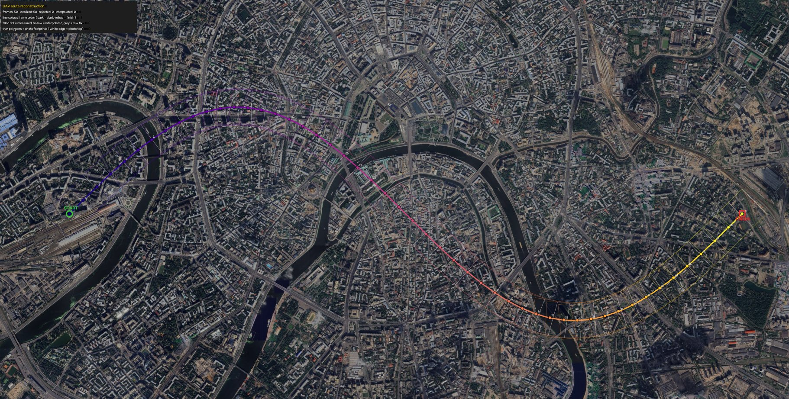

# UAV visual navigation — route reconstruction from drone photos

It-Jim CV test task 2026, **standard level**. Given a satellite map and 50 consecutive
drone photos, the program finds every photo on the map, reconstructs the
flight route and draws it.



## Result on the provided data

| Metric | Value |
|---|---|
| Frames localized | **50 / 50** (no interpolation needed) |
| Mean RANSAC inliers per frame | ~290 |
| Mean reprojection RMSE of inliers | **0.30 map px** |
| Scale (map px per photo px) | 0.253 (constant: the photos are ~4x more detailed than the map) |
| Runtime (CPU, single thread) | ~3 s map features + ~0.12 s per frame |

Outputs in `outputs/`:

* `route.png` — full map with the route, numbered route points, START / FINISH,
  colour-coded order and photo footprints with their real size and rotation
  (white edge = top of the photo = drone heading);
* `trajectory.csv` — per-frame position (raw and smoothed, map px), heading,
  inliers, RMSE and status (measured / interpolated / rejected);
* `route.mp4` — optional fly-along video: zoomed map window following the drone,
  the current photo and a minimap;
* `matches/NNN.jpg` — debug: map crop | photo warped by the found homography | blend;
* `experiments.md` — ablation table used to choose the parameters.

## Quick start

```bash
pip install -r requirements.txt
python main.py --map data/global_map.png --frames data/crops --out outputs
# + fly-along video and debug overlays
python main.py --map data/global_map.png --frames data/crops --out outputs --video-out --debug
```

Frames are read from the folder and sorted in natural order (`crop_2` < `crop_10`),
so the file names define the flight order.

Main options: `--detector sift|orb|akaze`, `--frame-scale auto|<float>`,
`--ratio 0.75`, `--ransac-thr 5`, `--min-inliers 15`, `--clahe`.

## How it works

```
map ──► SIFT (once, tiled) ──► MapIndex ─────────────┐
                                                     ▼
photo ─► gray, downscale to map pixel size ─► SIFT ─► ratio-test match (local window → global fallback)
      ─► MAGSAC++ homography ─► sanity checks ─► centre / heading / footprint
all frames ─► outlier rejection ─► Kalman + RTS smoother (fills gaps) ─► route.png / route.mp4
```

1. **Preprocessing** (`drone_nav/io_utils.py`). Grayscale, area-downscaling.
   The photo is resized so that one photo pixel ≈ one map pixel; the factor is
   learned automatically from the first matched frames (`--frame-scale auto`).
2. **Features** (`drone_nav/features.py`). SIFT keypoints/descriptors, map
   computed once in tiles. FLANN kNN + Lowe ratio test (0.75).
3. **Localization** (`drone_nav/localize.py`). Matching only against map
   keypoints in a window around the predicted position (constant-velocity
   prediction), falling back to the whole map. Homography by MAGSAC++
   (`cv2.USAC_MAGSAC`), then checks: enough inliers, convex and non-mirrored
   footprint, sane perspective, scale consistent with previous frames.
   The photo centre projected by H is the drone position, the projected "up"
   vector gives the heading.
4. **Trajectory** (`drone_nav/trajectory.py`). Outlier rejection against a
   local quadratic motion fit, constant-velocity Kalman filter + RTS smoother
   with noise estimated from the data (fills failed frames), Catmull-Rom curve
   for drawing.
5. **Visualization** (`drone_nav/visualize.py`).

## Why these choices (short; see `docs/` for details)

* **SIFT** — scale and rotation invariant; the photos here are rotated by
  45–135° and 4x larger in scale. ORB localized only 31/50 frames in the same
  setting (`outputs/experiments.md`).
* **Homography** — nadir view of mostly flat city ground; RMSE 0.3 px shows the
  model fits.
* **Downscaling photos to map resolution** — same accuracy, 4x faster than full
  resolution; too much downscaling (0.15) halves the inlier count.
* **Local search window** — same result as global search, 8x faster per frame,
  and fewer chances to lock onto repeated texture elsewhere.
* **Robustness check** (`tools/gap_test.py`): with 10 frames removed and one
  fake 500-px outlier injected, the outlier is rejected and the missing frames
  are recovered with < 0.6 px error.

## Repository layout

```
main.py                    CLI entry point
drone_nav/io_utils.py      loading, natural sort, preprocessing
drone_nav/features.py      detectors, matching, map feature index
drone_nav/localize.py      frame-to-map localization
drone_nav/trajectory.py    outlier rejection, Kalman/RTS, interpolation
drone_nav/visualize.py     route image and video
tools/experiments.py       ablation table
tools/gap_test.py          interpolation / outlier robustness test
tools/boom_video.py        bonus: route video with an explosion at FINISH
docs/                      stage-by-stage reports (Ukrainian)
```

## Limitations

* The homography assumes flat ground; tall buildings and low altitude cause
  parallax (small here, since the "photos" are satellite crops).
* Works best when photo and map come from similar imagery. For strong season
  or sensor changes, a learned matcher (SuperPoint + LightGlue, LoFTR, RoMa)
  would be the next step; the pipeline is the same, only `features.py` changes.
* Positions are in map pixels; with a GeoTIFF map they can be converted to
  lat/lon with rasterio.
